# Get Stuff Done
### How to Deliver Real Impact

Pete Suggitt &bull; Engineering Fellow

<!-- .element: class="slide-image" -->

Note:
How can we get big stuff done at NW? Spot the cultural references…

---

## Bureaucracy & Red Tape

<!-- .element: class="slide-image" -->

Note:
This is not a walk through of the bank's bureaucracy you will be glad to hear.

---

## Introductions

<!-- .element: class="slide-image" -->

Note:
Intros are very important … tell them who you are … and why you are here …
- Engineering Fellow
- Involved in a number of EAEP projects over the years
- Given many teams feedback on their pitches over the years
I’m here to give you a sense of getting stuff done in NW in reality.

---

## A Story: The Five Monkeys

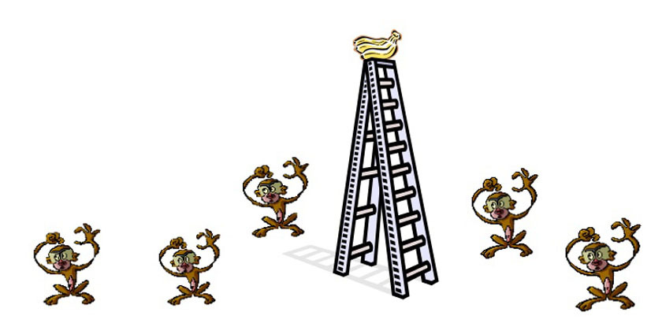<!-- .element: class="slide-image" -->

Note:
But before we get to that… a story. And I don’t care if it’s apocryphal. Apologies to those that have heard it already.
Several monkeys. One ladder. One bunch of bananas.
Monkeys like bananas. One climbs the ladder.

---

## The Cold Shower

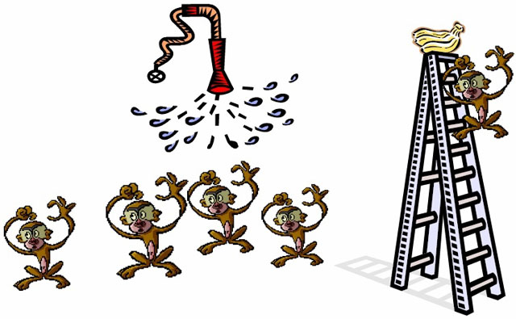<!-- .element: class="slide-image" -->

Note:
Everyone else gets sprayed with cold water. They’re not keen.

---

## The Consequence

<!-- .element: class="slide-image" -->

Note:
The now-cold monkeys beat up the monkey who went up the ladder.
This continues until no monkey attempts to scale the ladder.

---

## The Innocent Newcomer

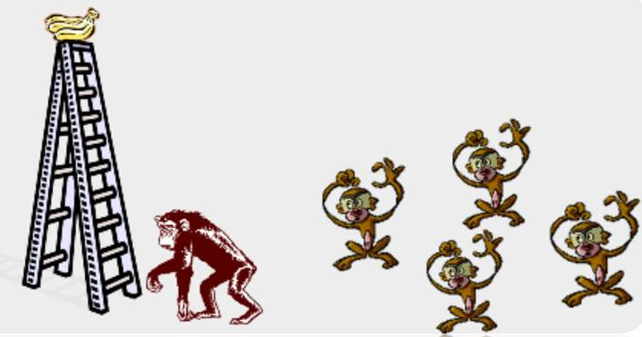<!-- .element: class="slide-image" -->

Note:
Now that everyone has learnt their lesson, we swap out one monkey for another.
This is an innocent monkey. It knows nothing of the cold shower.
It sees bananas. Naturally, it scales the ladder.

---

## Beatings Follow

<!-- .element: class="slide-image" -->

Note:
Beatings follow.

---

## Another Substitution

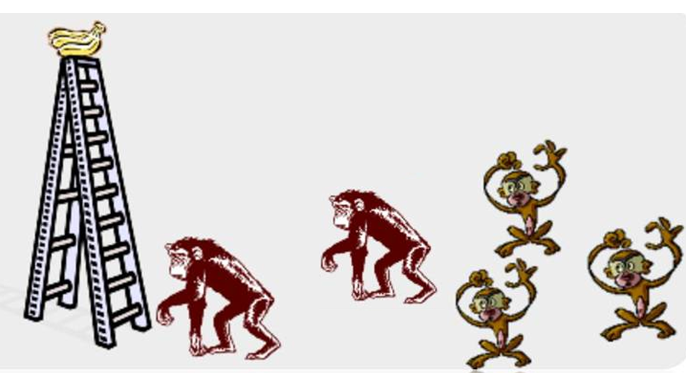<!-- .element: class="slide-image" -->

Note:
Another monkey is substituted.

---

## "It's What We Do"

<!-- .element: class="slide-image" -->

Note:
Beatings follow.
The previously naïve monkey joins in the beatings. Well, everyone else does it. It’s what we do.

---

## The Culture Trap

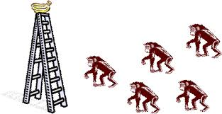<!-- .element: class="slide-image" -->

Note:
Eventually all of the original monkeys are replaced. None of these monkeys dare to ascend the ladder for fear of beatings.
But the original reason has been lost – after all, none of these monkeys have ever been sprayed with cold water.
“It’s what we do around here.”
Just because we’ve always done things a certain way doesn’t mean we shouldn’t change.

---

## Why We Are Here

<!-- .element: class="slide-image" -->

Note:
This is why we are here … this is the point of the EAEP course …

---

## A Secret Mission

<!-- .element: class="slide-image" -->

Note:
Pete joined the firm in 2023. Joined as the Principal Engineer for Corporate and Investment CDIO.
My role was C&I limited and focused on engineering and architecture.
But I had a secret mission: Change the culture to one focused on engineering … get the function excited about engineering again.

---

## Start Small

<!-- .element: class="slide-image" -->

Note:
Start small … what’s the smallest thing you could do?
- Run a coding kata ... Get some interest in it …
- Feedback from the teams was super positive … they like learning
- We had a number of people try it and take it on
- We had the whole of a management team doing it
Key message: do small things that have impact …

---

## Expect Setbacks

<!-- .element: class="slide-image" -->

Note:
You will have setbacks … people do daft things:
- Someone came to me to tell me that they were not allowing a contractor to attend … permies only (missed the point … this is about developing our teams … not individuals)
- Someone else came to me to ask who would pay for the change in engineering in adopting TDD
Keep going … don’t give up.

---

## Scale & Let Go

<!-- .element: class="slide-image" -->

Note:
If it takes off think about how to scale … probably means you need to let it go …
Don’t be personally emotional about it … make it easy for it to succeed in its own right …
You can't do this alone.

---

## The Pitch

<!-- .element: class="slide-image" -->

Note:
Examples needed. At some point you need to pitch for some money … that’s why this is in this course … it's important.

---

## Anatomy of a Good Pitch

<!-- .element: class="slide-image" -->

Note:
Key points to a good pitch ... You have practiced this in this course … hope you had fun …
- Get them on the hook: an emotional statement … what if I told you we could get our license to operate taken away if we carry on like this
- Get the facts on the table: how many people testing manually, how well does this work
- Describe the complexity: prod issues, late delivery, high cost … describe a burning platform
- Show them that you have evaluated options: Use internal staff … use a vendor …
- Get the deal done … Why did we choose John?

---

## No Burning Platform

<!-- .element: class="slide-image" -->

Note:
Yay … we pitched … people got it … but no funding …
It didn’t work the first time … no burning platform … didn’t feel real … CIOs did not want to do it … people wanted the money for other things …
The burning platform was not the testing approach … the burning platform is too many people … high cost …
Key message: no one will buy it if there is no burning platform …

---

## Pivot

<!-- .element: class="slide-image" -->

Note:
When you get knocked down you need to think about how to pivot … be creative …
We needed the money, but the pitch was not right … we talked about efficiency …
Money talks … we created an invest to save program … we committed to actual headcount reduction from this investment.
This sounds awful right … not so … our manual testers are now all test engineers … we made the cuts overall … mostly through sensible management thinking ….
Key messages:
- Understand how to approach the problem differently … pivot
- Be committed … headcount reduction is a committed move … "we might if we test more" is not committed
- Side talk about the group party strategy … situation changes … talk to the right people.

---

## DevOps & Flow

<!-- .element: class="slide-image" -->

Note:
Alongside testing we started to focus a lot around devops … it’s a fun word to debate this one … if you want to see a debate kick off just for fun drop into a team of quality engineers and tell them you have a budget for a new devops team … drop the bomb and run …
To get a focus on devops we started to identify a few people who might be able to help get more focus on streamlining the delivery of change into production … I talked about this a lot to our senior leadership team:
- Value stream mapping
- CI / CD
- Infrastructure as code
- Three amigos as a team
- Even talked to them about pigs and chickens … interestingly this one DCO got it .. Yani
Everyone nodding at me … things are moving slowly … it's not supposed to be like this …

---

## Tailor the Message

<!-- .element: class="slide-image" -->

Note:
They didn’t get it …
Not that they thought it was a bad idea … simply didn’t get it …
Paul feeding steak to a baby … the team needed weening …
Know who you are talking to and adjust your message so they can consume it … the right message in the wrong way won't work.

---

## Tenacity

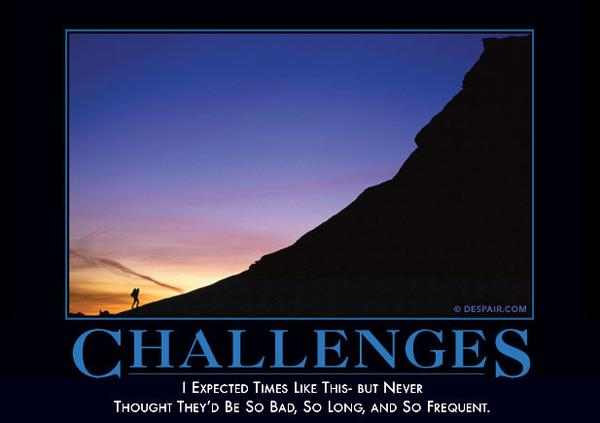<!-- .element: class="slide-image" -->

Note:
Change is a continuous thing … culture change is even harder … people are involved and then don’t necessarily understand …
You will need patience, a thick skin and lots and lots of tenacity …
Worst of all you will get people who just don’t want to see the change …
Key message: you are dealing with people … emotions and unconscious bias are your biggest enemy.

---

## The Hype Cycle

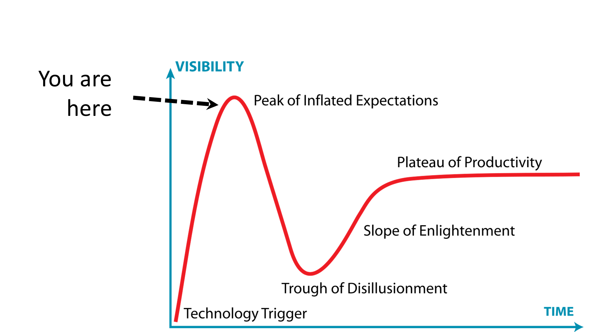<!-- .element: class="slide-image" -->

Note:
Be aware of the hype cycle. This is you now with your projects …
We have seen a lot of projects in the GEE course some have gone on to succeed:
- Git pub
- DB Open Source
- Kafka Monitoring
- Fabricert
- Understanding Engineers
There were another 30 odd projects … not to mention all the ones from this engineering day …

---

## The Effort Required

<!-- .element: class="slide-image" -->

Note:
Be prepared to work some extra hours if this isn’t your day job.
Blogging takes effort. Conferences / presentations take effort. Building relationships takes effort. Getting stuff done takes effort.

---

## Don't Give Up

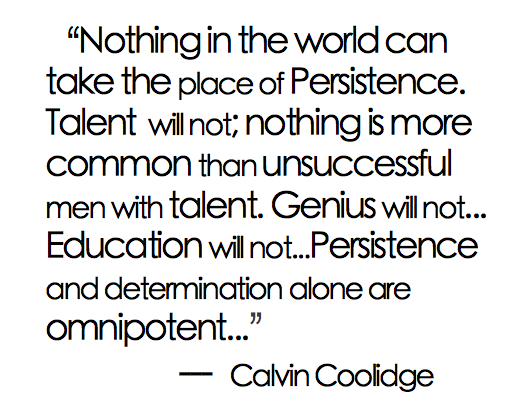<!-- .element: class="slide-image" -->

Note:
In short, don’t give up.

---

## With Help From Friends

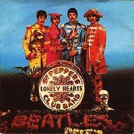<!-- .element: class="slide-image" -->

Note:
Get by with a little help from your friends:
- GEE community and faculty
- Distinguished Engineer Community
- Senior Leaders like Alain and the others that you meet on your journey
We can help you …

---

## Even If You Fail, You Win

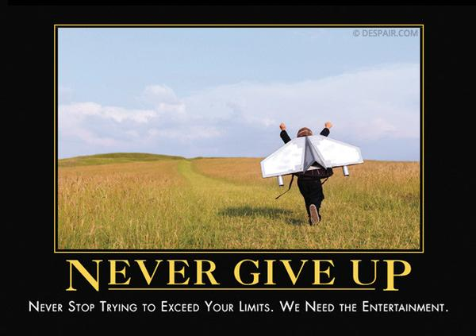<!-- .element: class="slide-image" -->

Note:
Or, for the pessimists in the room…
Even if you fail, you win … consider:
- Failures from those that try and get up again are lessons
- Most failures mean we try again differently
- Most of the senior leaders in the firm care more about you trying to fix things than the actual outcome
Failure is good … in the engineering culture … we want to create an arena of psychological safety for innovators.
Theodore Roosevelt speak … Man in the Arena.

---

## The Man in the Arena

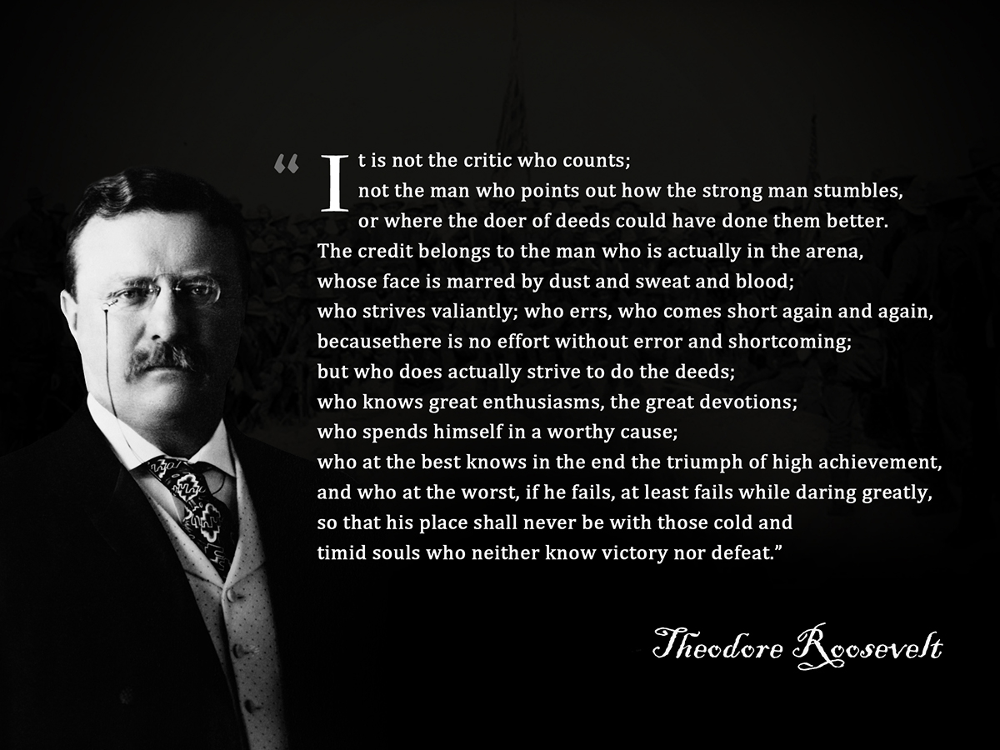<!-- .element: class="slide-image" -->

Note:
Bear with me on the clichés … this is one to remember.

---

## Questions?

<!-- .element: class="slide-image" -->

Note:
Questions?
